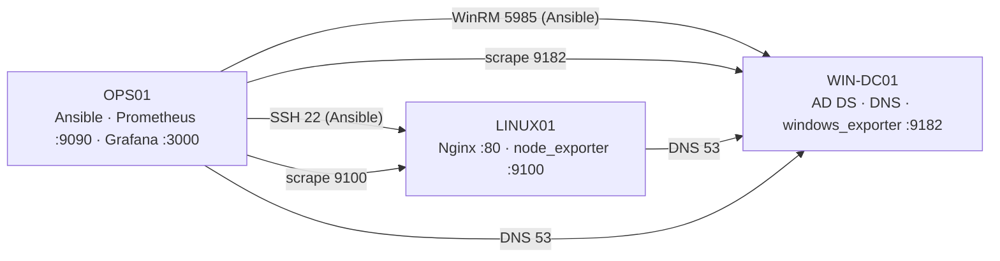

# InfraReady — administration Linux/Windows automatisée et supervisée

Projet fil rouge du module **Administration systèmes Linux/Windows** (Bachelor 3 Cybersécurité, YNOV Montpellier).
L'entreprise fictive InfraReady veut une infrastructure **reproductible, documentée et supervisée** : un domaine Active Directory, un serveur Linux de services, un poste d'administration qui automatise (Ansible) et surveille (Prometheus/Grafana), le tout validé automatiquement par GitHub Actions.

[](../../actions/workflows/validation.yml)

## Architecture

| Machine | OS | Rôle | IP (VMnet1) |
|---|---|---|---|
| WIN-DC01 | Windows Server 2025 | AD DS + DNS `infraready.test`, windows_exporter | 192.168.50.10 |
| LINUX01 | Ubuntu Server 24.04 | Nginx, disque de données monté, node_exporter | 192.168.50.20 |
| OPS01 | Ubuntu Server 24.04 | Ansible, Git, Prometheus, Grafana, node_exporter | 192.168.50.30 |

Réseau isolé `192.168.50.0/24` (host-only, sans passerelle) ; Internet uniquement par une carte NAT branchée temporairement pour les installations et mises à jour. Détails : [docs/architecture.md](docs/architecture.md), [docs/adressage-ip.md](docs/adressage-ip.md).



## Contenu du dépôt

```
infraready/
├── README.md
├── ansible.cfg                 inventaire par défaut, vérification des clés d'hôte
├── requirements.yml            collections Ansible (ansible.windows, community.windows, community.general)
├── inventory/
│   ├── hosts.yml               groupes linux, supervision, windows
│   └── group_vars/             connexion, services critiques, seuils, ports (aucun secret)
├── playbooks/
│   ├── linux.yml               Nginx + page déployée + pare-feu ufw            (tâche D)
│   ├── windows.yml             dossier, script de contrôle, service DNS         (tâche D)
│   ├── monitoring.yml          node_exporter, windows_exporter, Prometheus, Grafana (tâche F)
│   ├── maintenance.yml         contrôles, mises à jour Linux/Windows, redémarrage encadré (tâche E)
│   ├── verification.yml        contrôles fonctionnels en lecture seule
│   ├── templates/  files/
├── monitoring/
│   ├── prometheus.yml          cibles de collecte
│   ├── rules/alertes.yml       seuils et alertes
│   ├── dashboards/             tableau de bord Grafana (JSON généré)
│   └── grafana/provisioning/   source de données + fournisseur de tableaux de bord
├── scripts/
│   ├── linux/check-nginx.sh    contrôle de service (code retour exploitable)
│   ├── windows/s3_ad_structure.ps1   OU, groupes AGDLP, comptes, partage (tâche B)
│   └── outils/                 génération du tableau de bord, contrôle de cohérence (CI)
├── docs/                       architecture, adressage, sécurité, supervision, maintenance, incident, scénarios de panne, dossier PDF, présentation
└── .github/workflows/validation.yml
```

## Prérequis

- VMware Workstation (17+) ; 3 VM installées selon [docs/architecture.md](docs/architecture.md), snapshots avant chaque étape importante.
- Sur OPS01 : `ansible-core` 2.16+, `python3-winrm`, Git, accès SSH par clé `ed25519` (passphrase + `ssh-agent`) au compte `ansible` de LINUX01, compte de domaine `svc_ansible` pour WinRM.
- Carte NAT temporaire sur OPS01/LINUX01 pour les installations (`monitoring.yml`, `maintenance.yml`).

## Utilisation (depuis la racine du dépôt, sur OPS01)

```bash
eval "$(ssh-agent)" && ssh-add ~/.ssh/id_ed25519_lab      # une fois par session
ansible-galaxy collection install -r requirements.yml       # une fois

# Toujours : syntaxe -> simulation -> exécution -> vérification
ansible-playbook playbooks/linux.yml --syntax-check
ansible-playbook playbooks/linux.yml --check --diff -K
ansible-playbook playbooks/linux.yml -K
ansible-playbook playbooks/windows.yml -k

ansible-playbook playbooks/monitoring.yml --limit supervision -K
ansible-playbook playbooks/monitoring.yml --limit linux -K
ansible-playbook playbooks/monitoring.yml --limit windows -k

ansible-playbook playbooks/maintenance.yml --limit linux -K
ansible-playbook playbooks/verification.yml --limit supervision,linux -K
ansible-playbook playbooks/verification.yml --limit windows -k
```

`-K` : mot de passe sudo · `-k` : mot de passe WinRM de `svc_ansible`. Les mots de passe sudo diffèrent entre OPS01 et LINUX01, d'où les `--limit` séparés.

Accès à la supervision depuis l'hôte : Grafana `http://192.168.50.30:3000` (tableau « InfraReady - etat du laboratoire »), Prometheus `http://192.168.50.30:9090/classic/targets` et `/classic/alerts` (le paquet Ubuntu de Prometheus ne fournit que l'interface « classic »).

## Intégration continue

À chaque push ou pull request, [validation.yml](.github/workflows/validation.yml) exécute : `yamllint`, inventaire, `--syntax-check` de chaque playbook, `ansible-lint` (profil production), `promtool check config/rules`, régénération du tableau de bord (doit être identique), contrôle de cohérence inventaire ↔ Prometheus ↔ README, `shellcheck`, `PSScriptAnalyzer`, recherche de secrets `gitleaks` sur tout l'historique.

Le runner hébergé par GitHub **n'a aucune route vers le labo privé** : il valide le code, il ne déploie pas. Un déploiement automatique demanderait un runner auto-hébergé sur OPS01 (facultatif, non retenu : surface d'attaque supplémentaire).

## Suivi des tâches

| Tâche | Contenu | État |
|---|---|---|
| A | VM, réseau, DNS, schéma | ✅ séance 2 — tests T01–T08 24/24 |
| B | AD DS, OU, groupes AGDLP, comptes, partage | ✅ séance 3 — [securite.md](docs/securite.md) |
| C | Comptes, permissions, 2e disque monté (fstab), services, journaux Linux | ✅ séance 4 |
| D | Playbooks Linux et Windows, idempotence | ✅ séance 4 — 2e passage `changed=0` |
| E | Maintenance et mises à jour | ✅ séance 6 — LINUX01/OPS01 mis à jour, Windows Update en rescue (DC sans Internet) — [maintenance.md](docs/maintenance.md) |
| F | Prometheus, Grafana, seuils et alertes | ✅ séances 5–6 — 4 cibles up, 7 alertes, tableau provisionné |
| G | Dépôt GitHub + Actions | ✅ séance 7 — [run vert](https://github.com/N8lyuG/infraready/actions/runs/42532082985) : 4 jobs (lint, supervision, scripts, secrets) |
| H | Diagnostic d'incident | ✅ séance 6 — détection 22 s, résolution en 7 min — [incident.md](docs/incident.md) + [scénarios S4](docs/scenarios-pannes.md) |

Les preuves (captures) sont rangées hors dépôt par séance (`preuves/SXX/SXX_NN_machine_sujet.png`) et reprises dans le dossier technique PDF.

## Limites connues

- WinRM en HTTP 5985 (messages chiffrés par NTLM) ; HTTPS 5986 avec certificat non mis en place.
- `svc_ansible` est membre de *Domain Admins* (simplicité du labo) ; en production : délégation limitée / JEA.
- Pas d'Alertmanager : les alertes sont visibles dans Prometheus et Grafana, pas envoyées par e-mail.
- Pas de NTP centralisé pour les Linux ; pas d'accès Internet en exploitation (mises à jour par NAT temporaire).
- Partage de fichiers hébergé sur le contrôleur de domaine (acceptable en labo uniquement).
- Les secrets ne sont jamais versionnés ; ils sont saisis à l'exécution (`-K`, `-k`).

## Auteurs

Binôme InfraReady — NalyuG (Guylan) et binôme. Module encadré par A. Irkha, YNOV Montpellier, 2026.
