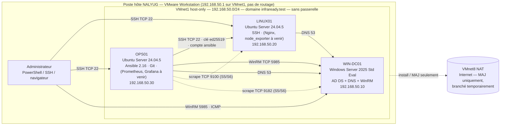

# Architecture InfraReady

> État validé le 22/10/2026 (fin de séance 2) — tests de réception T01→T08 : 24/24 réussis.
> Preuves : `preuves/S02/` (voir README).

## Schéma

Légende : trait plein = flux en service et testé ; pointillé = flux prévu (supervision) ou temporaire (NAT).

## Rôles

| Machine | OS | Rôle | Ressources | Snapshots |
|---|---|---|---|---|
| WIN-DC01 | Windows Server 2025 Standard Evaluation (Desktop Experience), build 26100.33650 | Contrôleur de domaine `infraready.test` (niveau 2025), DNS intégré AD, WinRM | 2 vCPU · 4 Go · 50 Go NVMe · UEFI | 00-installation-propre, 01-reseau-labo, 02-dc-operationnel |
| LINUX01 | Ubuntu Server 24.04.5 LTS | Services Linux (web, stockage, comptes) | 2 vCPU · 2 Go · 30 Go SCSI (LVM) · UEFI | 00-installation-propre, 01-reseau-labo |
| OPS01 | Ubuntu Server 24.04.5 LTS | Administration : Ansible core 2.16.3, pywinrm, Git ; supervision à venir | 2 vCPU · 4 Go · 50 Go SCSI (LVM) · UEFI | 00-installation-propre, 01-reseau-labo |

## Flux autorisés (en service)

| Source | Destination | Port / proto | Motif | Validation |
|---|---|---|---|---|
| OPS01 | LINUX01 | TCP 22 | Ansible / SSH par clé, compte `ansible` | `ssh ansible@LINUX01` + journal `Accepted publickey` |
| OPS01 | WIN-DC01 | TCP 5985 | WinRM (Ansible Windows, S4) | `nc -vz 192.168.50.10 5985` |
| LINUX01, OPS01 | WIN-DC01 | UDP/TCP 53 | DNS du domaine | `getent hosts`, `dig SRV` |
| Hôte (192.168.50.1) | LINUX01, OPS01 | TCP 22 | Administration | `ssh nalyug@…` |
| Hôte, VM du labo | WIN-DC01 | ICMP echo | Tests (règle « LAB - ICMPv4 echo depuis 192.168.50.0/24 ») | `Test-Connection` |

## Choix et écarts documentés

- **Réseau isolé sans passerelle** : VMnet1 host-only ; l'hôte ne route pas (Forwarding désactivé). Internet uniquement via une carte VMnet8 NAT pendant installation et mises à jour (« chemin NAT contrôlé », kit §5.1).
- **UEFI sur les 3 VM** (choix de cohérence, non exigé pour Linux).
- **Fuseau Europe/Paris** sur les 3 machines (corrélation des journaux).
- **Compte d'automatisation dédié** `ansible` (sudo) ; clé ed25519 protégée par passphrase, chargée via `ssh-agent`.
- Limites connues : pas de NTP pour les Linux tant que le DC n'est pas configuré comme source de temps ; pas d'accès Internet en exploitation (MAJ par bascule NAT temporaire).
